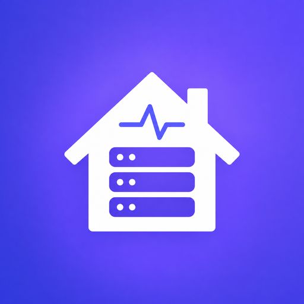
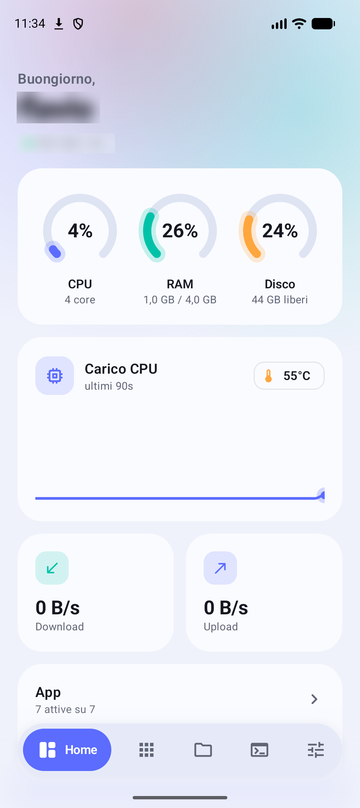
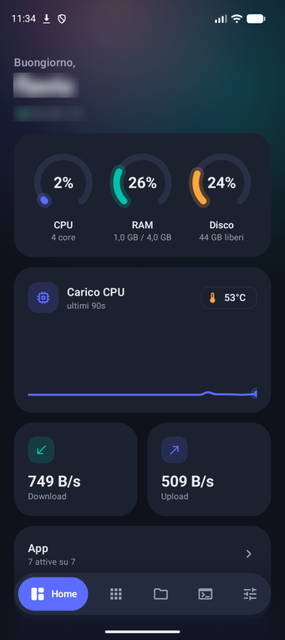
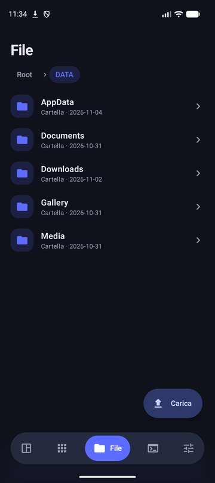
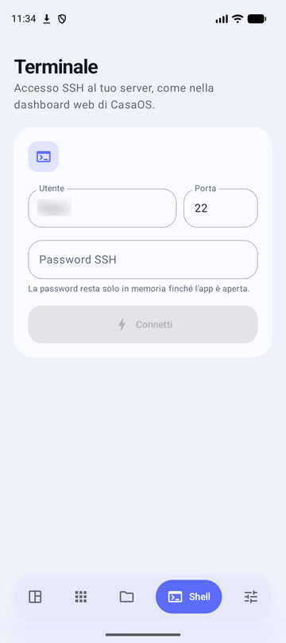
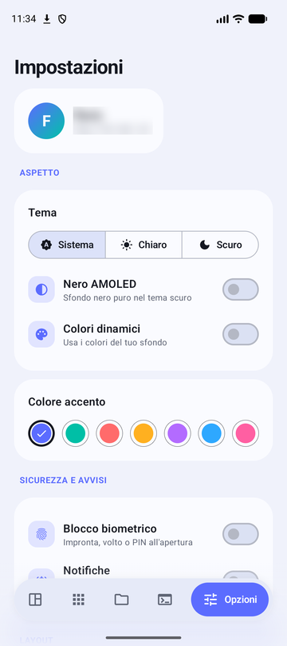
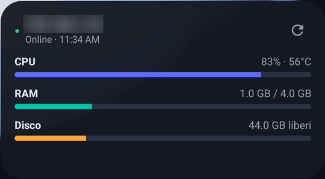

<p align="center">
  
</p>

<h1 align="center">CasaDeck</h1>

<p align="center">
  A native Android companion app for your <a href="https://casaos.io">CasaOS</a> home server.<br>
  Monitor, manage files, launch apps and open a shell — all from your phone.
</p>

<p align="center">
  <a href="../../releases/latest"></a>
  
  
</p>

---

## Screenshots

<p align="center">
  
  
  
</p>
<p align="center">
  
  
</p>
<p align="center">
  
</p>

## Features

- **Live dashboard** — CPU, RAM, disk, temperature, network speed and a 90-second CPU load chart.
- **Apps** — see and open the apps installed on your CasaOS, with their running status.
- **File manager** — browse your server, upload files and whole folders (uploads continue in the background).
- **SSH terminal** — connect to your server's shell; the password stays in memory only while the app is open.
- **Home screen widgets** — server resources, server status and a CasaOS apps grid.
- **Quick Settings tile** — jump to your apps from the notification shade.
- **Notifications** — background monitoring alerts you when something goes wrong.
- **Biometric lock** — fingerprint, face or PIN on launch.
- **Theming** — light / dark / system, pure-black AMOLED, Material You dynamic colors and accent picker.

## Install

1. Download `CasaDeck.apk` from the [latest release](../../releases/latest).
2. Open it on your phone and allow installing from unknown sources if asked.
3. Enter your CasaOS address (e.g. `http://192.168.1.10`) and your CasaOS credentials.

Requires Android 8.0 (API 26) or newer and a reachable CasaOS instance (usually on your home LAN).

## Build from source

```bash
git clone https://github.com/carellice/CasaDeck.git
cd CasaDeck
./gradlew assembleRelease
```

The APK lands in `app/build/outputs/apk/release/`. Release builds are signed with the debug key so they install directly; use your own keystore if you redistribute.

## Notes

- Cleartext HTTP is allowed because CasaOS on a home network is usually served over plain `http`.
- CasaDeck is an unofficial client and is not affiliated with the CasaOS / IceWhale team.
